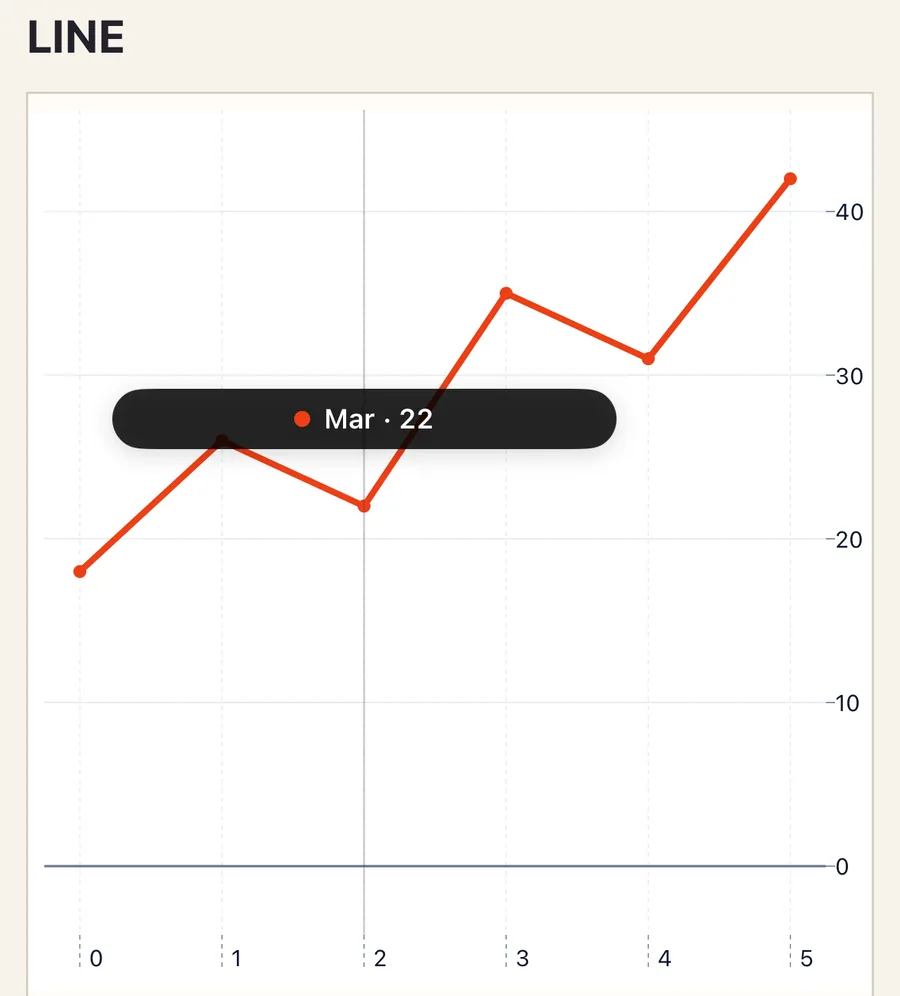
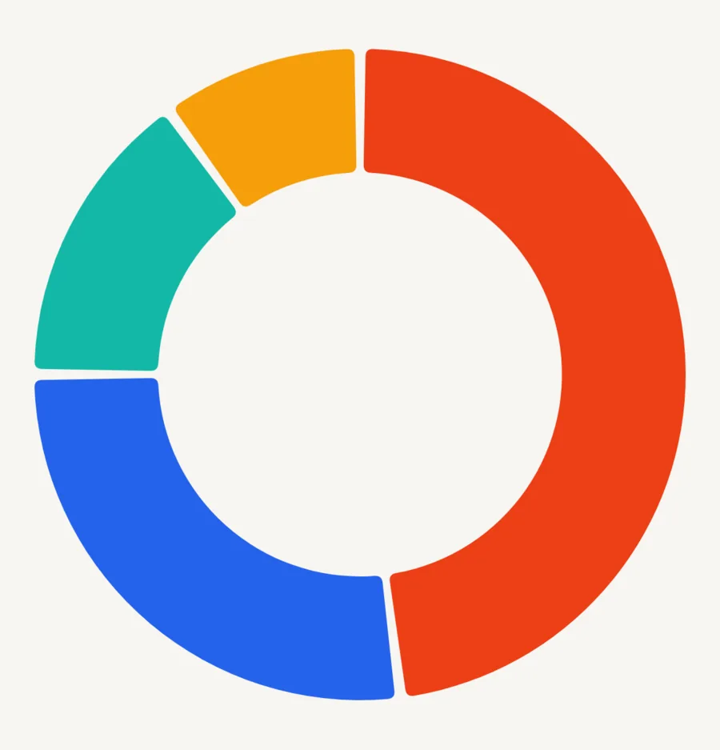
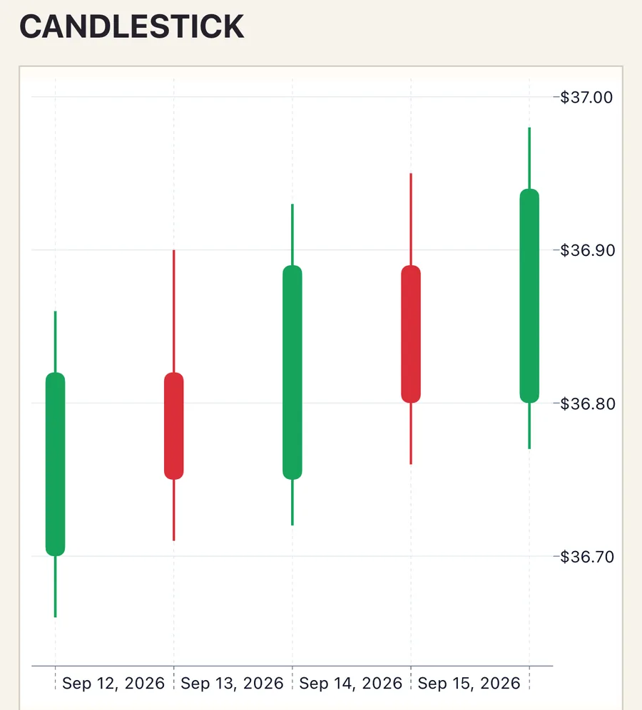
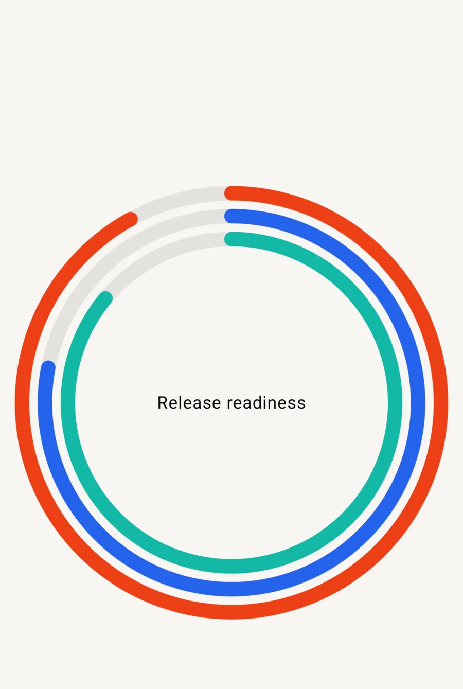

<p align="center">
  <picture>
    <source media="(prefers-color-scheme: dark)" srcset="docs/public/brand/nativephp-charts-lockup-dark.svg">
    
  </picture>
</p>

# NativePHP Charts

Native charts for NativePHP Mobile: give your Laravel-powered iOS and Android apps line, bar, area, scatter, pie, donut, candlestick, radar, progress, and heatmap charts rendered with Swift Charts and Jetpack Compose, configured from Blade or PHP, with no WebView or JavaScript.

[](https://packagist.org/packages/donmanueldev/nativephp-charts)
[](https://packagist.org/packages/donmanueldev/nativephp-charts)
[](https://packagist.org/packages/donmanueldev/nativephp-charts)
[](https://github.com/donmanueldev/nativephp-charts/actions/workflows/ci.yml)
[](https://donmanueldev.github.io/nativephp-charts/)
[](LICENSE.md)

> NativePHP Charts is an independent community plugin. It is not an official NativePHP package.

<p align="center">
  
  
  
  
</p>

<p align="center"><sub>Screenshots from the native renderers: line and candlestick on iOS, donut and progress on Android.</sub></p>

## Install

```bash
composer require donmanueldev/nativephp-charts
php artisan vendor:publish --tag=nativephp-plugins-provider --no-interaction
php artisan native:plugin:register donmanueldev/nativephp-charts --no-interaction
php artisan native:plugin:list
php artisan native:plugin:validate
```

The renderers compile into the native app, so rebuild your iOS or Android target after installing or updating the package.

**[Read the documentation](https://donmanueldev.github.io/nativephp-charts/)** for chart guides, native previews, and the full API reference.

## Contents

- [Why native instead of a WebView chart library](#why-native-instead-of-a-webview-chart-library)
- [Requirements](#requirements)
- [Quick start](#quick-start)
- [Chart types](#chart-types)
- [Shared options](#shared-options)
- [Selection callbacks](#selection-callbacks)
- [Apps using NativePHP Charts](#apps-using-nativephp-charts)
- [Contributing](#contributing)
- [Support and security](#support-and-security)

## Why native instead of a WebView chart library

- Each chart is drawn by the platform UI toolkit: Swift Charts and SwiftUI Canvas on iOS, Jetpack Compose Canvas on Android. It sits in the same native view hierarchy as the rest of your NativePHP screen.
- Charts expose native accessibility elements to VoiceOver and TalkBack, with localized value summaries and actions to move between points.
- Charts follow system settings: light and dark appearance with `theme="system"`, the reduced-motion preference, and the user's text size for axis and legend labels.
- Numbers, currencies, percentages, and dates are formatted by the platform formatters for the chart's `locale`.
- There is no JavaScript bundle, WebView, or chart service. Chart data goes from the PHP runtime on the device to the native renderer, and the package makes no network requests, so charts work offline.

## Requirements

| Requirement | Supported |
| --- | --- |
| PHP | `^8.4` |
| NativePHP Mobile | `^4.0` |
| Android | API 26 or newer |
| iOS | 18.2 or newer |
| NativePHP Desktop / WebView | Not supported |

## Quick start

Charts are leaf elements inside a NativePHP `NativeComponent` screen. A first chart needs a component class, a native route, and an EDGE Blade view.

Create `app/NativeComponents/SalesDashboard.php`:

```php
<?php

namespace App\NativeComponents;

use Illuminate\View\View;
use Native\Mobile\Edge\NativeComponent;

final class SalesDashboard extends NativeComponent
{
    public function render(): View
    {
        return view('native.sales-dashboard');
    }
}
```

Register the screen in your routes file:

```php
use App\NativeComponents\SalesDashboard;
use Illuminate\Support\Facades\Route;

Route::native('/', SalesDashboard::class);
```

Create `resources/views/native/sales-dashboard.blade.php`. Give the chart an explicit height and describe its purpose with `a11y-label`:

```blade
<native:column class="w-full h-full gap-4 p-4 safe-area">
    <native:text class="text-2xl font-bold">Ventas</native:text>

    <native:line-chart
        class="w-full h-80"
        :series="[[
            'id' => 'monthly-sales',
            'name' => 'Ventas',
            'color' => '#0F766E',
            'points' => [
                ['id' => 'sales-jan', 'label' => 'Ene', 'value' => 42000],
                ['id' => 'sales-feb', 'label' => 'Feb', 'value' => 51800],
                ['id' => 'sales-mar', 'label' => 'Mar', 'value' => 62400],
            ],
        ]]"
        locale="es-NI"
        value-format="currency"
        currency-code="NIO"
        :maximum-fraction-digits="0"
        a11y-label="Ventas mensuales en córdobas"
    />
</native:column>
```

The same `series` contract powers line, area, bar, scatter, and candlestick charts. Every series needs a unique `id`, a `name`, and ordered `points`; `color` is optional and otherwise comes from the active preset. Give every interactive point a stable `id` so selection survives updates and reordering.

The same chart can be built in PHP with the fluent element API, for example `LineChart::make()->series($series)->a11yLabel('Monthly sales')`. See [Blade and PHP equivalence](https://donmanueldev.github.io/nativephp-charts/reference/blade-php/).

## Chart types

| Chart | Element | Data | Chart-specific options |
| --- | --- | --- | --- |
| [Line](https://donmanueldev.github.io/nativephp-charts/charts/line/) | `<native:line-chart>` | Ordered `series` and `points` | `fill_to` between series, line and point styles |
| [Area](https://donmanueldev.github.io/nativephp-charts/charts/area/) | `<native:area-chart>` | Ordered `series` and `points` | `area-mode="overlay\|stacked"`, gradient fill |
| [Bar](https://donmanueldev.github.io/nativephp-charts/charts/bar/) | `<native:bar-chart>` | Ordered `series` and `points` | `mode="grouped\|stacked"`, `orientation="vertical\|horizontal"` |
| [Scatter](https://donmanueldev.github.io/nativephp-charts/charts/scatter/) | `<native:scatter-chart>` | Ordered `series` with numeric, date, or datetime `x` | Numeric x-axis by default |
| [Candlestick](https://donmanueldev.github.io/nativephp-charts/charts/candlestick/) | `<native:candlestick-chart>` | One series of `open`, `high`, `low`, `close` points | Rising, falling, neutral, and wick styles |
| [Pie](https://donmanueldev.github.io/nativephp-charts/charts/pie/) | `<native:pie-chart>` | Ordered `segments` | Segment gap, corner radius, and opacity |
| [Donut](https://donmanueldev.github.io/nativephp-charts/charts/donut/) | `<native:donut-chart>` | Ordered `segments` | `inner-radius-ratio` from `0.2` to `0.85` |
| [Radar](https://donmanueldev.github.io/nativephp-charts/charts/radar/) | `<native:radar-chart>` | 3 to 24 `axes`, plus `series` with one value per axis | `grid-levels`, `fill-opacity` |
| [Progress](https://donmanueldev.github.io/nativephp-charts/charts/progress/) | `<native:progress-chart>` | Up to 24 `metrics` with values from `0` to `1` | `center-label`, ring track, gap, and cap styles |
| [Contribution heatmap](https://donmanueldev.github.io/nativephp-charts/charts/contribution-heatmap/) | `<native:contribution-heatmap>` | Daily `values` with unique ISO dates | `end-date`, `days`, `week-starts-on`, `colors`, `empty-color`, month and weekday labels |

Each chart page has a complete Blade example, iOS and Android screenshots, and its validation rules.

## Shared options

Every chart accepts:

- `a11y-label`, `empty-label`, and `error-label` for the accessible description, the empty state, and the message shown when the native renderer rejects a snapshot.
- `theme` (`light`, `dark`, or `system`) and `preset` (`default`, `spectrum`, `contrast`, or your own preset from `config/nativephp-charts.php`).
- `locale`, `value-format` (`number`, `currency`, or `percent`), `currency-code`, and `minimum-fraction-digits` / `maximum-fraction-digits`.
- `legend`, `style` (platform-neutral style sections), `animated`, and a `_select` callback.

Line, area, bar, scatter, and candlestick charts also accept `x-axis` and `y-axis` maps, `show-grid`, `show-points`, `begin-at-zero`, `annotations` (reference lines and bands), `interaction` (tap or scrub, crosshair, tooltip), `viewport` with `on-viewport-change` (pan and zoom on number, date, and datetime axes), and `sampling` (LTTB for dense line, area, and scatter series). On a date or datetime x-axis, set the IANA zone with `timeZone`; `timezone` is accepted as an alias.

The [API reference](https://donmanueldev.github.io/nativephp-charts/reference/api/) lists every attribute, accepted value, default, and style key. Invalid data or options throw `InvalidArgumentException` in PHP before anything is rendered.

## Selection callbacks

Bind `_select` to a public method on the surrounding `NativeComponent`. The method receives the selection as a JSON string; decode it with `PointSelection::fromJson()`.

```php
use Donmanueldev\NativephpCharts\PointSelection;

public ?string $selectedPointId = null;

public function pointSelected(string $payload): void
{
    $selection = PointSelection::fromJson($payload);

    $this->selectedPointId = $selection->pointId;
}
```

Use `pointId`, `seriesId`, `x`, and `value` for application logic, and treat `localizedValue` as display text. The fluent API uses `->onSelect('pointSelected')`. See [callbacks and interactions](https://donmanueldev.github.io/nativephp-charts/guides/callbacks-interactions/) for the full payload and viewport callbacks.

## Apps using NativePHP Charts

- [Despertá](https://desperta.momotombo.dev/) ([Google Play](https://play.google.com/store/apps/details?id=dev.momotombo.desperta))

## Contributing

```bash
composer test
swift test
```

PHP tests cover normalization, serialization, and callback decoding. Swift tests compile the iOS renderers and cover their behavior. See [CONTRIBUTING.md](CONTRIBUTING.md) for the full setup, including the documentation site.

## Support and security

Use [GitHub Issues](https://github.com/donmanueldev/nativephp-charts/issues) for reproducible bugs and feature requests. Follow [SECURITY.md](SECURITY.md) to report vulnerabilities privately.

## License

NativePHP Charts is open-source software licensed under the [MIT license](LICENSE.md).
